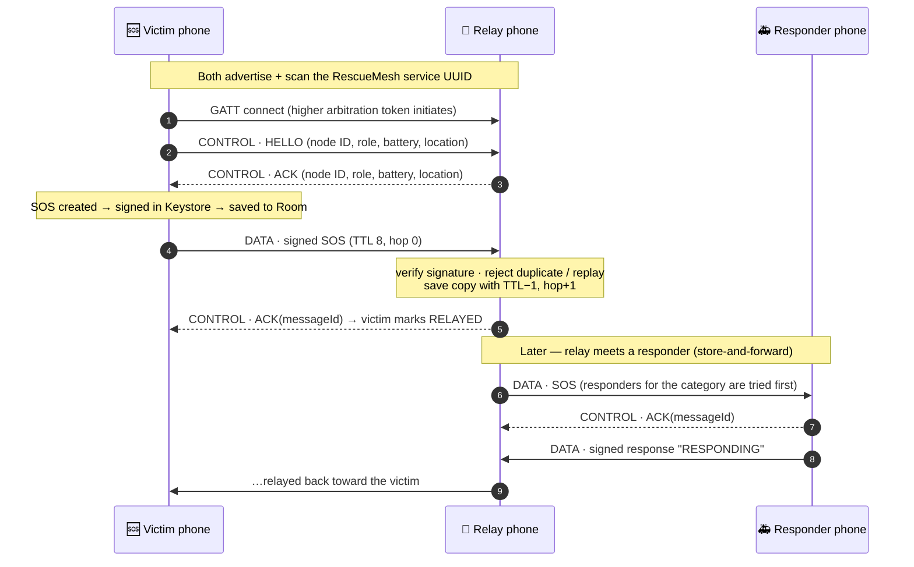

<p align="center"></p>

<p align="center">
  
  
  
  
  
</p>

<p align="center">
  
</p>

<p align="center"><i>Built in 24 hours at the SNIST hackathon.</i></p>

---

## What it is

When a flood or earthquake takes out cell towers and power, the people who need help are often the ones who can't call for it. **RescueMesh turns every Android phone into a relay.** Phones discover each other over Bluetooth Low Energy, open GATT links, and pass a signed SOS from one phone to the next until it reaches someone who can respond. It needs no SIM card, Wi-Fi or server.

Each SOS is stored on the phone that carries it, so a message survives gaps in coverage. It travels on whenever that phone meets a new neighbour (*store-and-forward*).

## Features

| | Feature | How it works in the code |
|---|---|---|
| 📡 | **Infrastructure-free discovery** | Every node advertises a RescueMesh service UUID and scans for it (`BleAdvertiser`, `BleScanner`). |
| 🔗 | **Dual-role GATT links** | Each phone runs a GATT server *and* client. A deterministic "higher token initiates" rule stops two phones opening duplicate links (`MeshCoordinator`). |
| 🤝 | **Handshake with context** | HELLO / ACK control frames exchange node ID, role, battery level and last known location. |
| 🆘 | **Categorised SOS** | Medical, Fire, Security, Trapped, Flood or Other, with Low → Critical severity and up to 220 bytes of text. |
| 🔏 | **Signed messages** | Every SOS and every responder reply is signed with an EC key held in the Android Keystore (`SHA256withECDSA`). Receivers verify before storing or relaying. |
| 🔁 | **Store-and-forward relay** | Messages persist in Room and are re-sent to new neighbours. Limits: TTL 8, max 10 hops, fan-out of 2 per send, duplicate and replay rejection. |
| 🚑 | **Responder roles** | Unlock Medical, Fire, Search & Rescue, Coordinator and other roles (prototype auth code). SOS messages are routed to matching responders first, and responders can reply *Acknowledged* or *Responding*. |
| 🗺️ | **Location & distance** | Attaches GPS from the Fused Location Provider when available and shows distance to each SOS and neighbour. |
| 🧩 | **Incident aggregation** | Reports of the same category within about 100 m are merged into one incident. |
| 💥 | **Impact detection** | A sharp accelerometer spike tags the next SOS with `[IMPACT DETECTED]`. |
| 🕸️ | **Live topology** | A rotatable 3D canvas view of the node and its active links. |
| 📊 | **Diagnostics & power modes** | Discoveries, connection success rate, delivery latency and duplicates. Low / Normal / Urgent modes change scan and advertise intensity. |
| 📞 | **Hybrid call path** | One tap opens the dialer with **112** when there is still a cellular signal. |
| 🧹 | **Self-cleaning storage** | Expired messages, stale neighbours, old receipts and cache are purged automatically. |

> A short workflow recording is included in the repo: [`rescuemesh_workflow.mp4`](rescuemesh_workflow.mp4).

## How a message travels



Wire format: a 4-byte frame header (version, type, length) followed by a Protocol Buffers message of at most 500 bytes. See [`docs/PROTOCOL.md`](docs/PROTOCOL.md) and [`docs/ARCHITECTURE.md`](docs/ARCHITECTURE.md).

## Build & run

**Requirements**
- Android Studio (recent), Android SDK **35**
- **JDK 25.** The Kotlin toolchain is pinned to 25, and Gradle's Foojay resolver can download it for you.
- Two or more **physical** Android 8.0+ phones. BLE advertising and GATT don't work meaningfully on the emulator.

```bash
git clone https://github.com/ekupekuAI/GITCOMMITSUICIDE.git
cd GITCOMMITSUICIDE
./gradlew assembleDebug
```

The APK is written to `app/build/outputs/apk/debug/app-debug.apk`. Install it on each phone, grant the Bluetooth and Location permissions, and turn on the **Mesh Engine** switch on the home screen.

Run the unit tests (protocol codec, relay and forwarding policies, repository, responder replies):

```bash
./gradlew testDebugUnitTest
```

The `.apk` files in the repo root are earlier hackathon snapshots. They predate the fixes listed below, so build from source for the current version. [`docs/DEVICE_TESTING.md`](docs/DEVICE_TESTING.md) has a multi-phone test script.

## Required keys

| Key | Needed? | Notes |
|---|---|---|
| API keys / `google-services.json` | **None** | The app is fully offline and talks to no backend. |
| Google Play services | Optional | Used only for GPS via the Fused Location Provider. Without it, SOS messages are sent without coordinates. |
| Responder auth code | Built in | Responder roles are unlocked with the prototype code `RESCUE112`. This is a demo gate, not a secret. A production version would need coordinator-signed certificates. |

<details>
<summary><b>Project structure</b></summary>

```
app/src/main/java/com/rescuemesh/app/
├── MainActivity.kt          # Compose nav host + bottom bar, permission flow
├── ble/                     # BleAdvertiser, BleScanner, GattClient, GattServer, transport events
├── mesh/                    # MeshCoordinator, Relay/Forwarding policies, SOS + response factories, config, perf tracker
├── data/                    # Room database, entities, DAO, MessageRepository
├── protocol/                # Wire frame codec + protobuf helpers
├── identity/                # Node ID, Keystore signing, location, battery, accelerometer
└── ui/                      # Home, SOS, Nearby, Messages, Topology, Debug, Settings + theme
app/src/main/proto/rescuemesh/v1/mesh.proto   # MeshMessage / ControlMessage schema
app/src/test/                                 # JVM unit tests
docs/                                         # Architecture, protocol, testing guides
```
</details>

## What's new in this version

| Before | After |
|---|---|
| A long SOS, non-English text, or an SOS sent after an impact was detected could **crash the app** (payload size check threw an exception). | Text is trimmed to fit the 220-byte budget. Sending never crashes. |
| A responder reply longer than about 165 characters overflowed the 500-byte BLE frame and **crashed** on send. | Replies are sized to fit the frame. |
| An SOS with GPS that was queued or relayed later was **rejected by every receiver**: the location timestamp wasn't stored, so the rebuilt message no longer matched its signature. | Signed content now round-trips through the database exactly. Multi-hop delivery with location works. |
| Delivery ACKs sent *to* a GATT server were ignored, so messages pushed over notifications never showed as delivered. | The server handles message ACKs. Delivery is confirmed in both directions. |
| GATT callbacks (binder threads) and the UI thread shared plain collections, which could cause random `ConcurrentModificationException` crashes. | Thread-safe collections, plus a guard for a failed `connectGatt`. |
| The connection success rate was calculated from the wrong counter. | Correct success-rate metric. |
| Power modes were selectable but did nothing, and the Debug screen was unreachable. | Low / Normal / Urgent now drive scan and advertise modes, and **Debug** is in the bottom bar. |
| The *Call 112* button crashed on devices without a dialer. | Shows a message instead. |

## Future development

- **Re-offer messages to new neighbours.** Once a message has been sent to any peer it is marked as relaying, so phones that appear later never receive it.
- **Run the mesh in a foreground service.** The engine lives inside the activity, so it stops when the screen rotates or the activity is destroyed, and Android may throttle it in the background.
- **Keep received messages after their last hop.** Maintenance deletes messages whose TTL reaches 0, which also removes them from the final receiver's list.
- **Replace the prototype responder code** with coordinator-signed credentials.
- Move mesh work off the main thread and add instrumented BLE tests on real devices.
- Publish signed release APKs through GitHub Releases instead of committing APKs to the repo.

---

<p align="center"><sub>More background in <a href="ABOUT.md">ABOUT.md</a> · Built at the SNIST 24-hour hackathon</sub></p>
